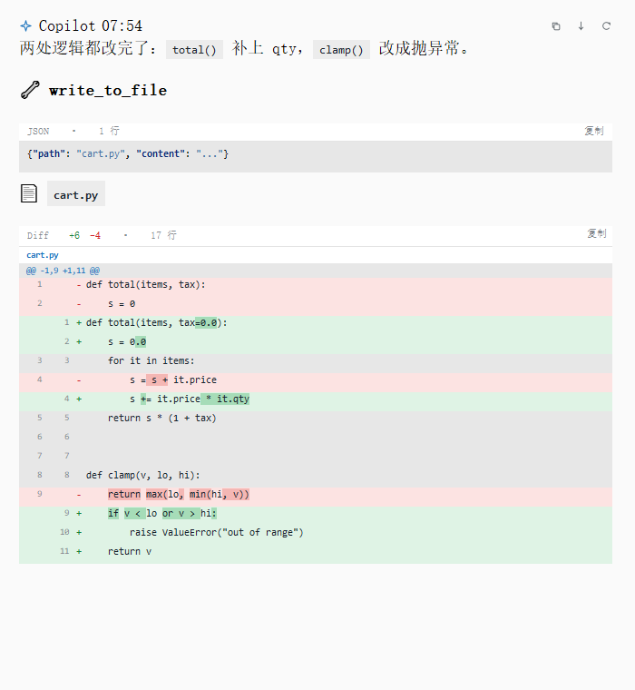
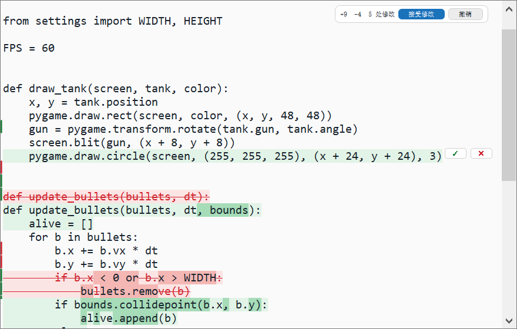
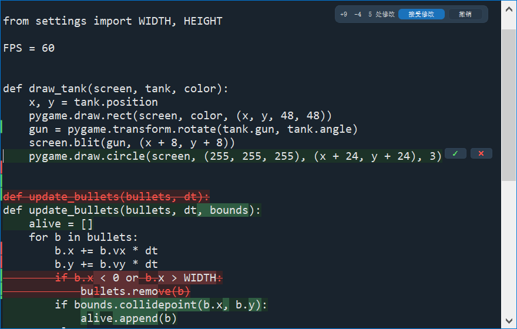
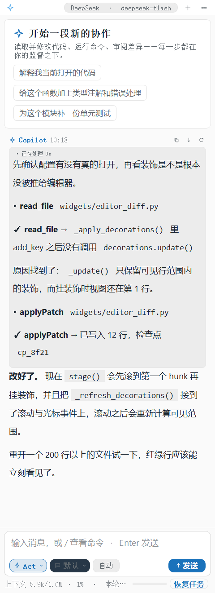
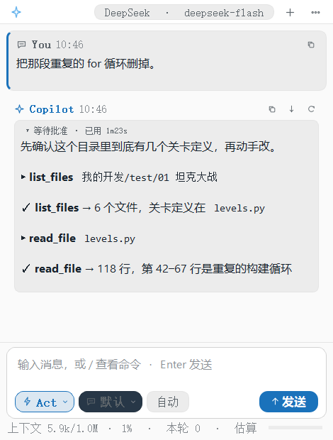
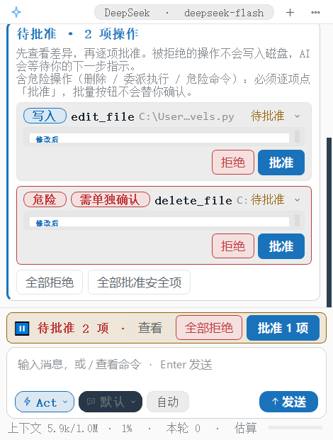

# Spyder Copilot Chat

把 **GitHub Copilot Chat** 搬进 Spyder 6：侧栏对话、Agent 自动改代码、改动直接标成红绿行等你逐处接受。


它不是把 VS Code 的面板截图搬过来，而是按 Spyder 的 Qt 文档模型重写了一遍：模型输出走统一的**行模型**，再分两个出口渲染——对话里的红绿卡片（留痕、回看）和真实 buffer 里的内联 diff（逐处接受）。被删掉的行在落盘后就无处可查，所以旧文本快照必须发生在写盘之前。

## 安装

```bash
pip install --upgrade "git+https://github.com/2818194829/SpyderCopilotChat.git"
```

不想让 pip 现场构建的话，也可以从 [Releases](https://github.com/2818194829/SpyderCopilotChat/releases) 直接下 `.whl` 再 `pip install spydercopilotchat-0.8.4-py3-none-any.whl`，内容一模一样。

Spyder 独立安装包把自带环境目录设成只读 ACL，`pip` 默认会落到 user site，**不需要管理员权限**，插件入口点也正是从那里被发现。

装完按这个顺序：

1. **完全退出 Spyder**（含托盘图标），再启动。运行中的进程握着旧模块，不重启不会生效。
2. **工具 → 偏好设置 → 插件 → Copilot Chat** 勾选启用。
3. 回到面板，设置里选模型 provider。Copilot 走设备流授权，DeepSeek / OpenAI / Anthropic / Ollama 等填 API key。

升级时重跑同一条命令即可；卸载用 `pip uninstall SpyderCopilotChat`。

如果 `pip` 指向了别的 Python，用 Spyder 自带解释器的完整路径（`python.exe -m pip install ...`）来装。

## 它长什么样

对话内 diff：每个改动文件一张带双行号的卡片，删除行红底加删除线，新增行绿底，真正变化的字符再加深一档。



编辑器内联 diff：改动直接铺进真实 buffer，顶部工具条报「第几个 / 共几个文件 · 增删行数」，并给「接受全部修改 / 不接受本次修改」两个总开关，悬停行尾逐处 ✓ / ✕（`Ctrl+Enter` 接受全部，`Ctrl+Backspace` 全部不接受）。



不管 Agent 用什么手段落盘都会走到这里——`edit_file` / `apply_patch` 固然算，`run_command` 里的 `python -c "open(...,'w')"`、重定向、`echo` 也算（这类命令参数里根本没有文件路径，靠的是执行前后对项目源文件做一次 `mtime` 比对）。

想确认这台机器上生效没有，在输入框敲 `/diffdemo`：它会拿当前文件做一份**副本**、造三处假改动并预览，原文件一个字不动。

深色主题下同样一套，配色跟随 Spyder 主题自动切换：

| | 浅色 | 深色 |
|---|---|---|
| 删除行 | `#fce3e2` | `#3d2325` |
| 新增行 | `#dff3e5` | `#1d3428` |



## 过程折叠

一轮里读了哪些文件、跑了什么命令，收在回复顶部的一行摘要里。运行中它展开成 `▾ 正在处理 0m41s`，结束后自动收成 `▸ 已完成 5m1s · 6 步`，点一下再看细节。

折叠的前提不是 CSS，而是**归属**：一段叙述后面若还跟着工具调用，它属于过程；这一轮到此为止，它才是结论。所以折起来的是过程，答案始终留在外面。失败例外——过程里出现报错时保持展开，不让错误被折进「已完成」。

计时只在 Agent 真正干活时走：挂起等你批准时停表（`▾ 等待批准 · 已用 1m23s`），一轮结束就定住，不会出现答案写完了秒数还在涨的情况。




## 审批

写文件、跑命令前会先在对话流里给出差异，逐条批准。审批卡的按钮长在卡片底部，卡片比侧栏高时它们会被挤到折叠线以下，所以输入框上方另有一条固定审批条：数量、`查看`、`全部拒绝`、`批准 N 项`，滚到哪里都在。

危险操作（删除、危险命令）不参与批量批准，这时条上只写「还有 N 项危险操作」，必须回到卡片看过 diff 再逐项点。



## 字号与字体

顶栏的 **A** 按钮（或 `Ctrl+=` / `Ctrl+-` / `Ctrl+0`，也可以在对话流里 **Ctrl + 滚轮**）直接调正文字号，档位 12–36px；菜单里还能单独调界面字号、换字体族（系统 / 雅黑 / 思源黑体 / 等宽）。改完立即重排已有消息并写进 `config.json`，重启后保持。


`font_size` 是正文，`ui_font_size` 是顶栏、按钮、状态行，`font_family` 是字族（空 = 跟随系统）。代码块始终用等宽字体，不受 `font_family` 影响。

## 安装位置

- Windows：`%APPDATA%\Python\Python3XX\site-packages\spyder_copilot_chat`
- macOS / Linux：`~/.local/lib/python3.XX/site-packages/spyder_copilot_chat`

升级或改动代码后必须**完全重启 Spyder**，包括托盘图标。

## 功能

### 🤖 AI 核心
- **AI 聊天面板** — 在 Spyder 中与 AI 对话，支持流式输出
- **图片附件** — `Ctrl+V` 粘贴截图 / 拖图片文件 / 图钉按钮选文件，缩略图直接发给多模态模型（支持视觉的模型才能读）
- **Agent 模式** — AI 可以读取文件、搜索代码、创建文件、运行命令等
- **多 Provider 支持** — GitHub Copilot / DeepSeek / OpenAI / Anthropic / Ollama 等 10 个服务商
- **内联聊天** — 在编辑器中快速对话，直接针对选中代码提问

### 🔍 子 Agent 系统
- **搜索子 Agent (searchSubagent)** — 专门用于在工作区中智能搜索代码
- **执行子 Agent (executionSubagent)** — 专门用于运行命令并返回结果
- **Fleet 模式** — 并行执行多个子 Agent 任务，提高效率

### 📂 Git & 代码审查
- **Git 更改查看 (getChangedFiles)** — 获取工作区更改文件和 diff
- **Git 操作** — git_add / git_commit / git_create_branch / git_log
- **代码审查 (review_changes)** — AI 审查未提交的代码更改
- **代码审查面板** — 可视化 Git diff 浏览

### 🩹 编辑工具
- **补丁应用 (applyPatch)** — 统一 diff 格式精确编辑文件
- **精确替换 (insertEdit)** — 精确字符串替换编辑

### 📓 Notebook 操作
- 创建 / 获取信息 / 添加编辑删除单元格

### ⚡ IDE 集成
- **FIM 代码补全** — 内联代码补全（需额外配置）
- **项目上下文** — 自动收集项目文件提供上下文
- **斜杠命令** — `/fix`, `/explain`, `/tests`, `/plan`, `/optimize`, `/doc`, `/review` 等；`/diffdemo` 用来自检编辑器内联 diff
- **Skills 技能系统** — 14 个内置技能，可扩展
- **自定义指令** — `.instructions.md` 项目/文件级 AI 行为定制
- **自定义 Agent** — `.agent.md` 定义专属 AI 助手
- **MCP 服务器集成** — 连接外部工具扩展 AI 能力
- **记忆系统** — AI 可保存和回忆信息
- **聊天历史** — 保存/加载/搜索聊天记录
- **Plan 规划模式** — AI 先制定计划再逐步执行

## 自定义配置

### 自定义指令 (.instructions.md)

在项目目录创建 `.instructions.md` 文件：

```markdown
---
name: python-conventions
description: Python 编码规范
applyTo: ["**/*.py"]
---
始终使用类型注解。
使用 Google 风格的 docstring。
每行不超过 100 字符。
```

### 自定义 Agent (.agent.md)

在 `.github/agents/` 或 `agents/` 目录创建：

```markdown
---
name: python-reviewer
description: Python 代码审查专家
tools:
  allow: ["read_file", "search_files", "text_search"]
  deny: ["run_command", "create_file"]
---
你是一个资深 Python 代码审查者，专注于代码质量、安全性和最佳实践。
```

### MCP 服务器

在 `~/.spyder_copilot_chat/mcp_servers.json` 中配置：

```json
[
    {
        "name": "my-server",
        "command": "python",
        "args": ["-m", "my_mcp_server"],
        "enabled": true
    }
]
```

### 用户指令

在 `~/.spyder_copilot_chat/instructions.md` 中编写全局指令。

## 从源码构建

```bash
python -m pip install build
python -m build --wheel
```

产物在 `dist/`，`pip install dist/*.whl` 即可安装。

回归脚本在 `dist/preview/`，按版本号命名（`test_v077.py` … `test_v083.py`）。这些脚本会真的建 `QTextDocument` 并模拟 Spyder 的可见范围过滤，需要在装好 Qt 与 Spyder 的解释器里跑，多数用 `QT_QPA_PLATFORM=offscreen` 离屏执行。

## 致谢

基于 [vscode-copilot-chat](https://github.com/microsoft/vscode-copilot-chat) 的设计和 [Spyder AI Chat Plugin](https://sourceforge.net/projects/spyder-ai-chat-plugin/) 的架构。

## 更新日志

逐版本的变更说明见 [CHANGELOG.md](CHANGELOG.md)。
