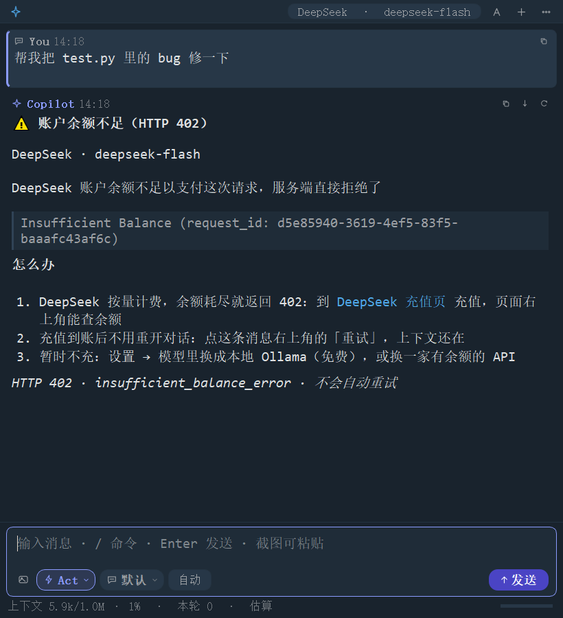
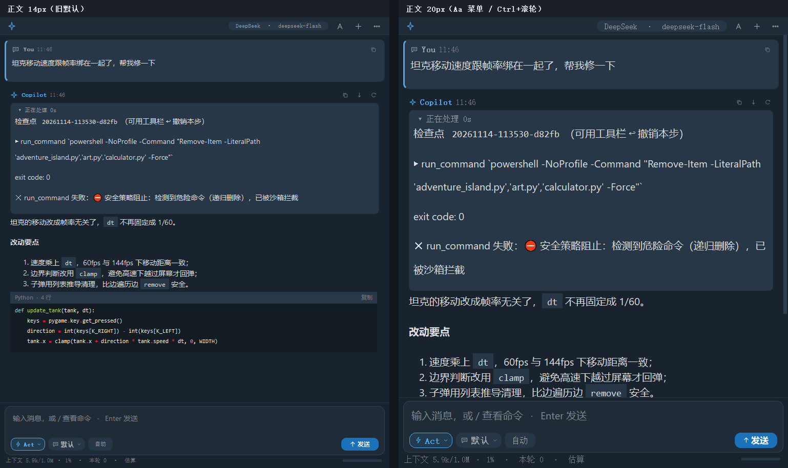
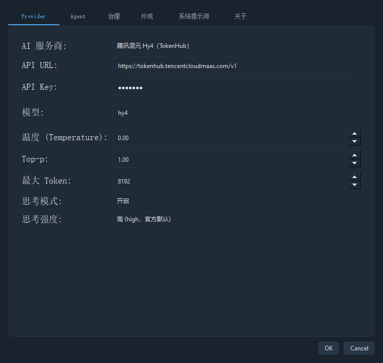
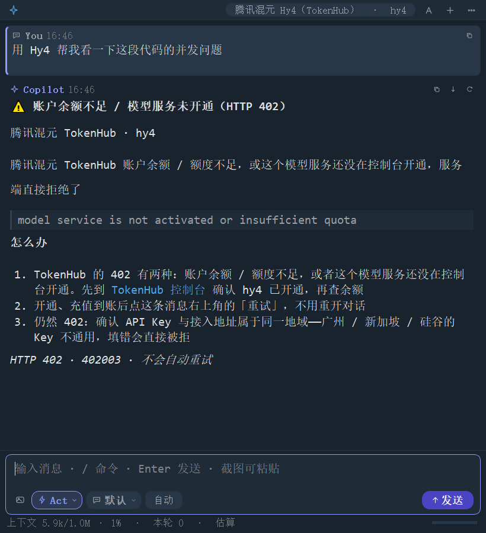
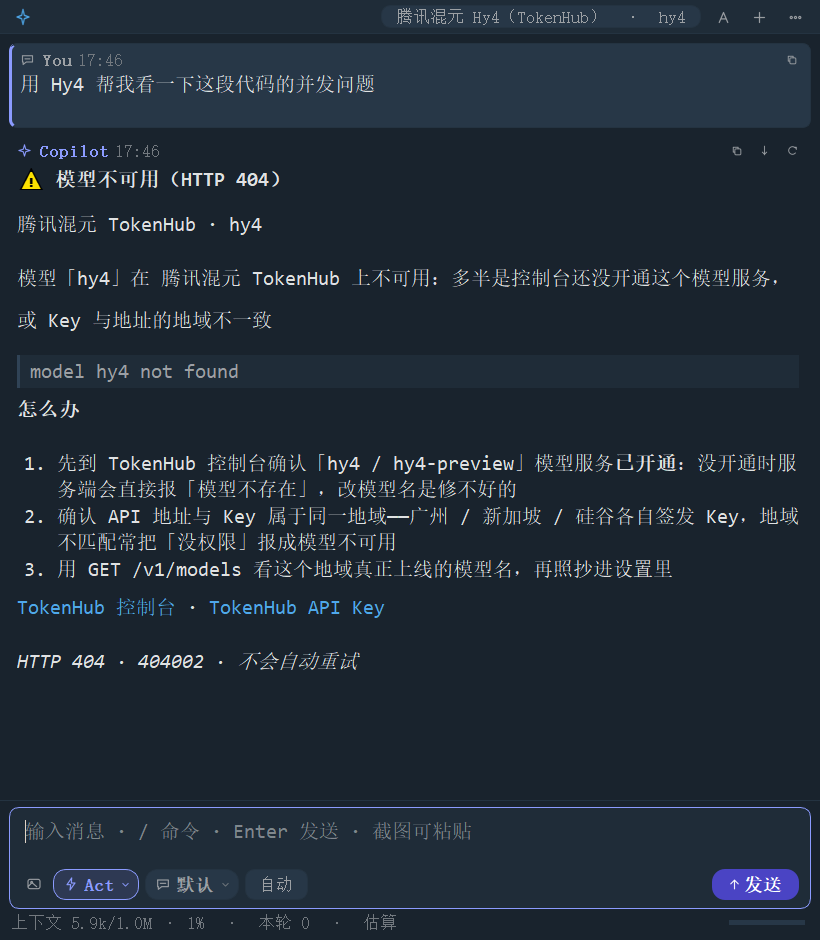
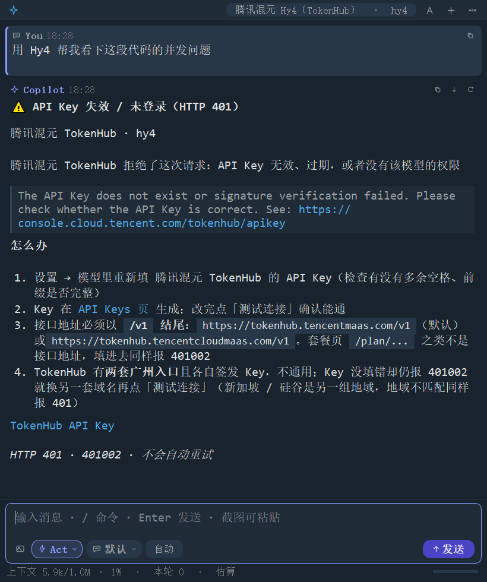

# Spyder Copilot Chat

把 **GitHub Copilot Chat** 搬进 Spyder 6：侧栏对话、Agent 自动改代码、改动直接标成红绿行等你逐处接受。


它不是把 VS Code 的面板截图搬过来，而是按 Spyder 的 Qt 文档模型重写了一遍：模型输出走统一的**行模型**，再分两个出口渲染——对话里的红绿卡片（留痕、回看）和真实 buffer 里的内联 diff（逐处接受）。被删掉的行在落盘后就无处可查，所以旧文本快照必须发生在写盘之前。

## 安装

### 方式一：一行命令装最新版（推荐，不需要 Git，国内网络可用）

```bash
python -m pip install --user --no-deps --upgrade --force-reinstall "https://cdn.jsdelivr.net/gh/2818194829/SpyderCopilotChat@main/latest/spydercopilotchat-0-py3-none-any.whl"
```

这条 URL **永远不变**：每次发版，发布流程会把新 wheel 覆盖到仓库的 `latest/` 目录，重跑同一行就是最新版。升级也是同一行。

为什么不用 `github.com/.../releases/download/...`：那个域名在国内经常连不上，pip 会连试 5 次然后报

```text
ConnectTimeoutError: Connection to github.com timed out. (connect timeout=15)
error: connection-timeout
```

配了清华 PyPI 镜像也没用——镜像只代理 PyPI 上的包，GitHub Release 的文件是 pip 直接去 `github.com` 取的，不经过镜像。jsDelivr 在国内有节点，实测可达。

> 文件名里的 `-0-` 是故意的：pip 要求 wheel 名字形如 `名称-版本-py3-none-any.whl`，版本段写死才能让 URL 固定。真实版本在 wheel 内部的 METADATA 里，装完 `pip show` 显示的是真实版本（当前 0.8.16）。`--force-reinstall` 不能省：版本没变时 pip 会说「already installed with the same version」，加它才保证每次都取 CDN 上当前那份。刚发版后 CDN 可能有最多约 12 小时缓存，急着要新包就用下面的方式二。

四个参数各有原因，别省：

| 参数 | 为什么 |
|---|---|
| `--user` | Spyder 独立安装包的自带环境是只读的，插件必须落进 user site（`%APPDATA%\Python\Python3XX\site-packages`），Spyder 才能发现入口点。用系统 Python / Anaconda 装时若它自己的 site-packages 可写，pip 会装到那个 Python 的目录里，Spyder 根本看不见 |
| `--no-deps` | `spyder` / `qtpy` / `requests` 由 Spyder 自带环境提供。若用别的 Python 装，pip 会为了满足 `spyder>=6.0` 把整套 Spyder + PyQt5 再拉一份进 user site；user site 优先级更高，会把 IDE 里的 Spyder 顶掉 |
| `--upgrade` / `--force-reinstall` | 覆盖旧版；见上面关于固定版本名的说明 |

更省事的是直接用 Spyder 自带的解释器（依赖它自己就有，不需要 `--no-deps`）：

```bash
"<Spyder 安装目录>\envs\spyder-runtime\python.exe" -m pip install --user --upgrade --force-reinstall <上面的 CDN URL>
```

不需要管理员权限。

### 方式二：从 Release 手动下载 / 加速直连

浏览器打开 [Releases](https://github.com/2818194829/SpyderCopilotChat/releases)，下最新版的 `.whl`，再：

```bash
python -m pip install --user --no-deps --upgrade 下载路径\spydercopilotchat-x.y.z-py3-none-any.whl
```

如果只是 `github.com` 连不上、但 `api.github.com` 通，PowerShell 里这一行会**自动查出最新版本号**再装（同一行，不写死版本）：

```powershell
python -m pip install --user --no-deps --upgrade --force-reinstall ('https://gh-proxy.com/' + ((Invoke-RestMethod 'https://api.github.com/repos/2818194829/SpyderCopilotChat/releases/latest' -TimeoutSec 20).assets | Where-Object { $_.name -like '*.whl' } | Select-Object -First 1).browser_download_url)
```

原理：`api.github.com` 在国内通常可达，先问它最新 Release 的 wheel 地址，再在前面加一层公共加速前缀下载。`gh-proxy.com` 是第三方服务，不保证长期可用；能直连 GitHub 的话把前缀去掉即可。已在国内网络实测通过。

### 方式三：装最新开发版（需要 Git，且 github.com 可达）

```bash
python -m pip install --user --no-deps --upgrade "git+https://github.com/2818194829/SpyderCopilotChat.git"
```

这条命令要求本机装了 **Git for Windows** 且 `git.exe` 在 PATH 里。否则会报：

```text
ERROR: Error [WinError 2] 系统找不到指定的文件。 while executing command git version
ERROR: Cannot find command 'git' - do you have 'git' installed and in your PATH?
```

这不是插件的问题：pip 要先用 `git clone` 把仓库拉到临时目录再现场构建，没 Git 就卡在第一步；`github.com` 连不上时同样会卡住（超时）。装 Git for Windows（安装时选 *Use Git from the Windows Command Prompt*，装完重开终端）并确认能连 GitHub 再试，或者直接用方式一——不需要 Git、不需要直连 GitHub、也不现场构建。

> 这个包目前没有发布到 PyPI，`pip install SpyderCopilotChat` 暂时不可用；`--no-deps` 这条路就是为此准备的。

装完按这个顺序：

1. **完全退出 Spyder**（含托盘图标），再启动。运行中的进程握着旧模块，不重启不会生效。
2. **工具 → 偏好设置 → 插件 → Copilot Chat** 勾选启用。
3. 回到面板，设置里选模型 provider。Copilot 走设备流授权；DeepSeek / OpenAI / Anthropic / Ollama 等填 API key；腾讯混元 Hy4 填 [TokenHub](https://console.cloud.tencent.com/tokenhub/apikey) 的 Key（见[腾讯混元 Hy4](#hunyuan)）。

想确认装对了：`python -c "import spyder_copilot_chat as p; print(p.__version__, p.__file__)"`，路径里应该有 user site（Windows 是 `AppData\Roaming\Python\...`）；如果指到别的 Python 的 `Lib\site-packages`，Spyder 是看不见的，按上面加 `--user` 重装一次。

升级时重跑同一条命令即可；卸载见下面的[卸载](#卸载)。

## 卸载

先**完全退出 Spyder**（含托盘图标）。运行中的进程握着插件模块，Windows 上这时卸载会有一半文件删不掉，留下一个 import 就报错的空壳。

### 一条命令删掉代码

```bash
python -m pip uninstall SpyderCopilotChat
```

解释器要对得上，`pip` 未必是 Spyder 用的那个。先查清楚装在哪：

```bash
python -c "import spyder_copilot_chat, sys; print(spyder_copilot_chat.__file__); print(sys.executable)"
```

第一行是包的实际位置，第二行就是该拿去卸载的解释器。Spyder 独立安装包的解释器在 `<Spyder 安装目录>\envs\spyder-runtime\python.exe`。装过两份（比如又给 Anaconda 装了一次）就分别在各自解释器里各卸一次。

验证：

```bash
python -c "import spyder_copilot_chat"   # 期望 ModuleNotFoundError
ls "$APPDATA/Python/Python312/site-packages" | grep -i copilot    # Windows
ls ~/.local/lib/python3.*/site-packages | grep -i copilot          # macOS / Linux
```

历史版本重装时改名留下的 `spydercopilotchat-*.dist-info.bak` 不在安装清单里，`pip` 不会碰它们，手动删掉就行。重启 Spyder，侧栏面板才会彻底消失。

### 配置和数据要不要一起删

装在 `~/.spyder_copilot_chat`（Windows 是 `%USERPROFILE%\.spyder_copilot_chat`），`pip uninstall` 不会动它：

| 文件 / 目录 | 里面是什么 | 删掉的后果 |
|---|---|---|
| `config.json` | API Key、模型、字号字体等全部设置 | 重装后要重新填 Key |
| `tokens.json` | GitHub Copilot 设备流令牌 | 重装后要重新授权 |
| `history/`、`sessions/` | 聊天记录与会话 | 历史对话不能再打开 |
| `attachments/` | 粘贴 / 拖入的图片文件 | 旧消息里的图变成空引用 |
| `audit/` | 每天一份的工具调用审计 JSONL | 操作留痕丢失 |
| `checkpoints/`、`index/` | 改文件前的快照、仓库索引 | 没影响，用到时会重建 |

**彻底删干净**（含 Key 与聊天记录）：

```bash
rmdir /s /q "%USERPROFILE%\.spyder_copilot_chat"                      # Windows cmd
Remove-Item -Recurse -Force "$env:USERPROFILE\.spyder_copilot_chat"   # Windows PowerShell
rm -rf ~/.spyder_copilot_chat                                         # macOS / Linux
```

**只清掉设置、保留聊天记录**：删 `config.json` 一个文件即可。

**只注销插件、保留配置**：不删这个目录，重装后 Key、模型、历史原样都在。

### Spyder 偏好里还留着一行

`~/.spyder-py3/config/spyder.ini` 里的 `[copilot_chat]` 段（`enable = True` 一类）由 Spyder 自己保存，卸载 wheel 不会清除。留着无害，重装后插件直接是启用状态；想回到从没装过的状态，就把 `copilot_chat/` 开头的行删掉，或在 工具 → 偏好设置 → 插件 里取消勾选。

### 想装回来

重跑安装那条命令即可。数据目录没删的话，Key、令牌、模型、聊天记录都不用重新配。

## 它长什么样

对话内 diff：每个改动文件一张带双行号的卡片，删除行红底加删除线，新增行绿底，真正变化的字符再加深一档。


编辑器内联 diff：改动直接铺进真实 buffer，顶部工具条报「第几个 / 共几个文件 · 增删行数」，并给「接受全部修改 / 不接受本次修改」两个总开关，悬停行尾逐处 ✓ / ✕（`Ctrl+Enter` 接受全部，`Ctrl+Backspace` 全部不接受）。


不管 Agent 用什么手段落盘都会走到这里——`edit_file` / `apply_patch` 固然算，`run_command` 里的 `python -c "open(...,'w')"`、重定向、`echo` 也算（这类命令参数里根本没有文件路径，靠的是执行前后对项目源文件做一次 `mtime` 比对）。

想确认这台机器上生效没有，在输入框敲 `/diffdemo`：它会拿当前文件做一份**副本**、造三处假改动并预览，原文件一个字不动。

深色主题下同样一套，配色跟随 Spyder 主题自动切换：

| | 浅色 | 深色 |
|---|---|---|
| 删除行 | `#fce3e2` | `#3d2325` |
| 新增行 | `#dff3e5` | `#1d3428` |


## 过程折叠

一轮里读了哪些文件、跑了什么命令，收在回复顶部的一行摘要里。运行中它展开成 `▾ 正在处理 0m41s`，结束后自动收成 `▸ 已完成 5m1s · 6 步`，点一下再看细节。

折叠的前提不是 CSS，而是**归属**：一段叙述后面若还跟着工具调用，它属于过程；这一轮到此为止，它才是结论。所以折起来的是过程，答案始终留在外面。失败例外——过程里出现报错时保持展开，不让错误被折进「已完成」。

计时只在 Agent 真正干活时走：挂起等你批准时停表（`▾ 等待批准 · 已用 1m23s`），一轮结束就定住，不会出现答案写完了秒数还在涨的情况。


## 审批

写文件、跑命令前会先在对话流里给出差异，逐条批准。审批卡的按钮长在卡片底部，卡片比侧栏高时它们会被挤到折叠线以下，所以输入框上方另有一条固定审批条：数量、`查看`、`全部拒绝`、`批准 N 项`，滚到哪里都在。

危险操作（删除、危险命令）不参与批量批准，这时条上只写「还有 N 项危险操作」，必须回到卡片看过 diff 再逐项点。


## 报错说人话

请求失败时给的是卡片，不是一串 `API 402: {"error":...}`：第一行说清是什么问题（余额不足 / Key 失效 / 限流 / 模型名错 / 对话太长 / 连不上），第二行列出发请求用的提供方和模型，接着引用服务端原文，然后给两三条能照着做的步骤——该充值的给充值页链接，该换模型的告诉你去哪换。

同一个状态码在不同服务商那里是几件不同的事：402 在 DeepSeek 是「余额不足」，在 Copilot 是「订阅额度用完」，在腾讯混元 TokenHub 还可能是「模型服务未开通」；401 在 TokenHub 最常见的是 Key 与地域不匹配。旧版本一律报成 Copilot 订阅额度，于是 DeepSeek 欠费的用户被要求去升级 Copilot 订阅。



余额不足、Key 错、模型名错这类错误**不会自动重试**（重试一百次也还是不够钱），页脚会写明；限流、5xx、网络抖动才值得重试。已经吐出来的半截回答不会被错误文案覆盖，卡片接在后面。

**API 出错不会弹 IDE 的崩溃窗口**（v0.8.15 起）。旧版本里服务端回一句「模型不可用」，Spyder 会弹出「Spyder遇到了内部错误！」的问题报告框——那不是进程崩溃：Spyder 6 把 `sys.stderr` 重定向到内部控制台，并把 error 流的每一行都当成未处理异常上报，而 `logging` 的 root handler 正好写 stderr，于是一句 `logger.error("Chat request failed: ...")` 就等价于向 IDE 报了崩溃。现在插件日志由 `safe_logging` 接管（不进 stderr，traceback 只留内存诊断缓冲），包内业务错误一律 `warning` 级别，错误仍然画成聊天面板里的卡片。想看诊断记录，在 Spyder 的内部控制台执行 `from spyder_copilot_chat import safe_logging; print(safe_logging.diagnostics_text())`；设环境变量 `SPYDER_COPILOT_CHAT_LOG=off` 可彻底静默控制台输出。

## 字号与字体

顶栏的 **A** 按钮（或 `Ctrl+=` / `Ctrl+-` / `Ctrl+0`，也可以在对话流里 **Ctrl + 滚轮**）直接调正文字号，档位 12–36px；菜单里还能单独调界面字号、换字体族（系统 / 雅黑 / 思源黑体 / 等宽）。改完立即重排已有消息并写进 `config.json`，重启后保持。



`font_size` 是正文，`ui_font_size` 是顶栏、按钮、状态行，`font_family` 是字族（空 = 跟随系统）。代码块始终用等宽字体，不受 `font_family` 影响。

<a id="hunyuan"></a>

## 腾讯混元 Hy4（TokenHub）

从 v0.8.14 起，设置页的「AI 服务商」里可以直接选 **腾讯混元 Hy4（TokenHub）**，不用再拿「OpenAI 兼容」手填地址。产品与接口文档见 [Hy AI Studio 文档中心](https://aistudio.tencent.com/hunyuan/doc-center)。

**三步配好**

1. 在 [TokenHub API Key 控制台](https://console.cloud.tencent.com/tokenhub/apikey) 创建 Key，并在 [TokenHub 控制台](https://console.cloud.tencent.com/tokenhub) 确认 `hy4` 模型服务已开通。
2. 设置里选「腾讯混元 Hy4（TokenHub）」→ 粘贴 Key → 模型选 `hy4`（或 `hy4-preview`）。
3. 确认 API 地址**以 `/v1` 结尾**，且与 Key 属于同一地域 / 同一套入口。

| 地域 | API 地址 |
|---|---|
| 广州（默认，短别名） | `https://tokenhub.tencentmaas.com/v1` |
| 广州另一套入口 | `https://tokenhub.tencentcloudmaas.com/v1` |
| 新加坡 | `https://tokenhub-intl.tencentcloudmaas.com/v1` |
| 硅谷 | `https://tokenhub-us.tencentcloudmaas.com/v1` |

> **v0.8.16 改了默认地址**：旧版默认的长域名对 TokenHub 控制台签发的 Key 会返回 `401002 API Key 不存在`，同一把 Key 在短别名域名则 `GET /v1/models` 返回 200。两套广州入口**各自签发 Key、互不通用**，旧配置里存了长域名的话请手动改成短别名（或改成你 Key 实际所属的那套）。地址必须以 `/v1` 结尾——`/plan/v3` 这类套餐页地址不是接口地址，填进去同样报 401002。v0.8.16 起，官方域名下路径不是 `/v1` 的配置会在读取时**自动纠正**成 `scheme://host/v1` 并打一条 `WARNING`（自定义代理域名不受影响），在设置页点保存即可写回。地址栏 tooltip 里列了全部备选。



**能力**：1M 上下文（960k 输入 / 64k 输出）、图片理解、Function Calling / Agent 工具调用、结构化输出。官方标注 Hy4 支持看图，插件按 OpenAI 多模态 `image_url` 格式发送，`Ctrl+V` 粘贴的截图可以直接问它。

**深度思考**：默认开启，插件用 `thinking: {"type": "enabled"}` 显式控制。思考强度只给 `high`（官方默认）和 `no_think`（等价于关思考）——`low` / `max` 是 DeepSeek 的取值，切到 Hy4 时会自动回落到 `high`，不会发成 400。带工具的 Agent 对话里会启用 Preserved Thinking，把上一轮的 `reasoning_content` 原样回填，避免多轮工具调用时缓存命中率下降。`max_tokens` 自动截到 64K 输出上限，流式请求会带 `stream_options.include_usage` 以便正确统计用量与成本（默认刊例价：输入 ¥6 / 百万 tokens、输出 ¥18 / 百万 tokens，可在设置里改）。

**报错**：TokenHub 的 402 有两种含义——账户余额 / 额度不足，或这个模型服务还没开通；401 最常见的是 Key 与地域 / 入口不匹配。错误卡片会按这两种情况分别给处置，不会再串成 DeepSeek 充值或 Copilot 订阅。流式响应里夹带的 `{"error": ...}` 帧（HTTP 200 里也可能出现）同样会被识别成错误，不会显示成「回答莫名中断」。

**v0.8.16 修了一个很坑的误诊**：`401002` 的原文是 `The API Key does not exist or signature verification failed`，旧版看到 `does not exist` 就把它判成「模型名写错」，于是报出「模型「hy4」在 TokenHub 上不可用」——用户照着改模型名永远修不好。现在 401/403 一律按鉴权处理，错误体里的 `authentication_error` 也参与判断；卡片会直接提示「地址要以 `/v1` 结尾」「两套广州入口 Key 不通用」。真正的模型名错误（如 `400004 The model or service ID ... does not exist`）仍归「模型不可用」，按「确认已开通 → 核对地域 → `GET /v1/models`」三步走。v0.8.15 起这类错误只在聊天面板出卡片，不会再让 Spyder 弹内部错误窗口。







> 这条链路按 TokenHub 公开的 OpenAI 兼容接口实现。**v0.8.16 已用真实 Key 做过线上验证**：`GET /v1/models` 返回 200（`hy4` 为 `online`、`hy4-preview` 为 `pre-offline`），`hy4` 的非流式 / 流式 / `no_think` 请求均返回 200，中文回答无乱码，`usage.completion_tokens_details.reasoning_tokens` 正常；插件 `ChatWorker` 的中文问答、多轮对话、`usage` 信号也全部跑通。回归测试仍用本地 mock 服务覆盖请求体 / SSE / 错误帧 / 工具回填，不会在测试里发线上请求。`hy4-preview` 官方另支持 `reasoning_effort: none`，设置页目前按正式版 `hy4` 统一给 `high / no_think`。

## 安装位置

- Windows：`%APPDATA%\Python\Python3XX\site-packages\spyder_copilot_chat`
- macOS / Linux：`~/.local/lib/python3.XX/site-packages/spyder_copilot_chat`

升级或改动代码后必须**完全重启 Spyder**，包括托盘图标。

## 功能

### 🤖 AI 核心
- **AI 聊天面板** — 在 Spyder 中与 AI 对话，支持流式输出
- **图片附件** — `Ctrl+V` 粘贴截图 / 拖图片文件 / 图钉按钮选文件，缩略图直接发给多模态模型（支持视觉的模型才能读）
- **Agent 模式** — AI 可以读取文件、搜索代码、创建文件、运行命令等
- **多 Provider 支持** — GitHub Copilot / 腾讯混元 Hy4 / DeepSeek / OpenAI / Anthropic / Ollama 等 11 个服务商（[Hy4 配置说明](#hunyuan)）
- **内联聊天** — 在编辑器中快速对话，直接针对选中代码提问

### 🔍 子 Agent 系统
- **搜索子 Agent (searchSubagent)** — 专门用于在工作区中智能搜索代码
- **执行子 Agent (executionSubagent)** — 专门用于运行命令并返回结果
- **Fleet 模式** — 并行执行多个子 Agent 任务，提高效率

### 📂 Git & 代码审查
- **Git 更改查看 (getChangedFiles)** — 获取工作区更改文件和 diff
- **Git 操作** — git_add / git_commit / git_create_branch / git_log
- **代码审查 (review_changes)** — AI 审查未提交的代码更改
- **代码审查面板** — 可视化 Git diff 浏览

### 🩹 编辑工具
- **补丁应用 (applyPatch)** — 统一 diff 格式精确编辑文件
- **精确替换 (insertEdit)** — 精确字符串替换编辑

### 📓 Notebook 操作
- 创建 / 获取信息 / 添加编辑删除单元格

### ⚡ IDE 集成
- **FIM 代码补全** — 内联代码补全（需额外配置）
- **项目上下文** — 自动收集项目文件提供上下文
- **斜杠命令** — `/fix`, `/explain`, `/tests`, `/plan`, `/optimize`, `/doc`, `/review` 等；`/diffdemo` 用来自检编辑器内联 diff
- **Skills 技能系统** — 14 个内置技能，可扩展
- **自定义指令** — `.instructions.md` 项目/文件级 AI 行为定制
- **自定义 Agent** — `.agent.md` 定义专属 AI 助手
- **MCP 服务器集成** — 连接外部工具扩展 AI 能力
- **记忆系统** — AI 可保存和回忆信息
- **聊天历史** — 保存/加载/搜索聊天记录
- **Plan 规划模式** — AI 先制定计划再逐步执行

## 自定义配置

### 自定义指令 (.instructions.md)

在项目目录创建 `.instructions.md` 文件：

```markdown
---
name: python-conventions
description: Python 编码规范
applyTo: ["**/*.py"]
---
始终使用类型注解。
使用 Google 风格的 docstring。
每行不超过 100 字符。
```

### 自定义 Agent (.agent.md)

在 `.github/agents/` 或 `agents/` 目录创建：

```markdown
---
name: python-reviewer
description: Python 代码审查专家
tools:
  allow: ["read_file", "search_files", "text_search"]
  deny: ["run_command", "create_file"]
---
你是一个资深 Python 代码审查者，专注于代码质量、安全性和最佳实践。
```

### MCP 服务器

在 `~/.spyder_copilot_chat/mcp_servers.json` 中配置：

```json
[
    {
        "name": "my-server",
        "command": "python",
        "args": ["-m", "my_mcp_server"],
        "enabled": true
    }
]
```

### 用户指令

在 `~/.spyder_copilot_chat/instructions.md` 中编写全局指令。

## 从源码构建

```bash
python -m pip install build
python -m build --wheel
```

产物在 `dist/`，`pip install dist/*.whl` 即可安装。

回归脚本在 `dist/preview/`，按版本号命名（`test_v077.py` … `test_v083.py`）。这些脚本会真的建 `QTextDocument` 并模拟 Spyder 的可见范围过滤，需要在装好 Qt 与 Spyder 的解释器里跑，多数用 `QT_QPA_PLATFORM=offscreen` 离屏执行。

## 致谢

基于 [vscode-copilot-chat](https://github.com/microsoft/vscode-copilot-chat) 的设计和 [Spyder AI Chat Plugin](https://sourceforge.net/projects/spyder-ai-chat-plugin/) 的架构。

## 更新日志

逐版本的变更说明见 [CHANGELOG.md](CHANGELOG.md)。
